<div align="center">

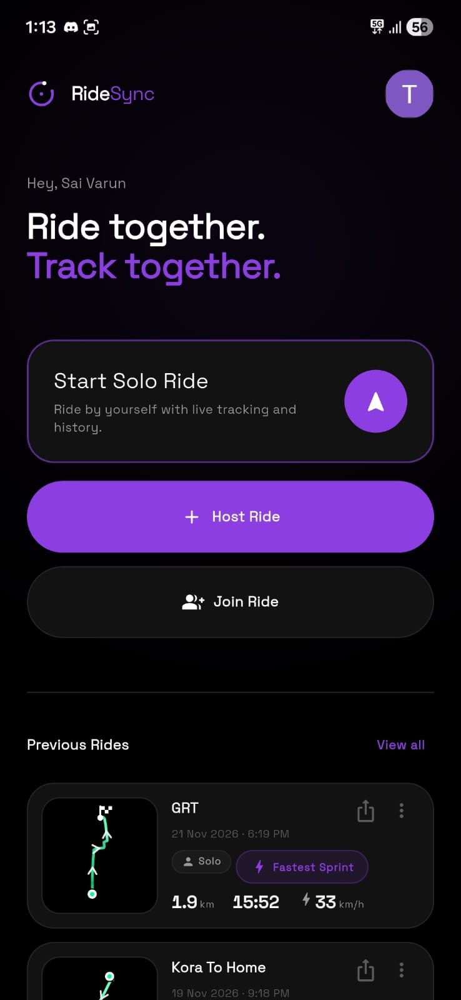

# RideSync

### Never lose your ride.

**Real-time solo and group motorcycle rides, built with Flutter and Firebase.**

<p>
  <a href="../../releases/latest"></a>
  <a href="../../releases"></a>
  <a href="../../actions/workflows/ci.yml"></a>
  <a href="LICENSE"></a>
  <br>
  
  <a href="https://flutter.dev"></a>
  <a href="https://dart.dev"></a>
  <a href="https://firebase.google.com"></a>
  <a href="https://www.openstreetmap.org"></a>
</p>

<a href="../../releases/latest"></a>

<sub>
<a href="#-features">Features</a> ·
<a href="#-screenshots">Screenshots</a> ·
<a href="#-tech-stack">Tech Stack</a> ·
<a href="#-folder-structure">Folder Structure</a> ·
<a href="#-installation">Installation</a> ·
<a href="#-running">Running</a> ·
<a href="#-roadmap">Roadmap</a> ·
<a href="#-contributing">Contributing</a>
</sub>

</div>

<br>

RideSync keeps riders together on the road and keeps every ride afterwards. Ride solo or host a group: every rider's position, speed and trail sync live, one planned route can guide the whole group with turn-by-turn directions, and each finished ride becomes a story with a replay, analytics and a share-ready card.

Sign in with Google and your rides, statistics and preferences follow you to any phone. Maps, search, routing and fuel stations all run on free, open OpenStreetMap services, with no paid map API.

> [!NOTE]
> RideSync is under active development. Features and screens can change between releases, and feedback is very welcome.

<br>

## ✨ Features

<table>
<tr>
<td width="50%" valign="top">

### 🏍️ Solo Riding

- **Free Roam:** start in one tap, ride anywhere
- **Guided Navigation** with turn-by-turn directions
- **Ride Replay** on the real GPS timeline
- **Ride Insights:** top speed, performance and highlights
- **Fuel stations** with brand markers
- **Smart Auto End** after a long genuine stop
- **Pause / Resume** for breaks
- **Share cards** with the real map and route

</td>
<td width="50%" valign="top">

### 👥 Group Riding

- **Ride rooms** joined with a 6-character code
- **Live rider tracking** with personal colours
- **Live Leaderboard** with gaps between riders
- **Group navigation** on one shared route
- **Rider trails** and **group replay**
- **Individual completion:** each rider ends their own ride
- **Live notices** when riders pause, re-route, rejoin or finish

</td>
</tr>
<tr>
<td width="50%" valign="top">

### ☁️ Accounts & Sync

- **Google Sign-In** with a rider name you choose
- **Cloud ride history** restored on any phone
- **Profile** with personal statistics
- **Sync status** and **Sync Now**
- **Settings sync:** name, solo colour, fuel layer
- **Offline saving:** rides upload when you're back online

</td>
<td width="50%" valign="top">

### 📊 Analytics

- **Ride score** and achievements (Longest Ride, Top Speed PB, Fastest Sprint)
- **Speed-coloured route map** with the top-speed spot
- **Moving vs idle time** and a speed graph
- **Automatic ride names** from where the ride ended
- **Totals, records and rides by type** on your profile
- **Background recording** with the screen off

</td>
</tr>
</table>

<br>

## 📸 Screenshots

### 🏠 Home

<table>
<tr>
<td align="center" width="50%"></td>
<td valign="middle">

**One screen to start any ride.**

- Greets you by your rider name
- **Start Solo Ride**, **Host Ride** or **Join Ride**
- **Previous Rides** with route thumbnails, distance, ride time, top speed and highlights
- Your profile one tap away, top right

</td>
</tr>
</table>

### 🔐 Authentication

<table>
<tr>
<td align="center" width="50%">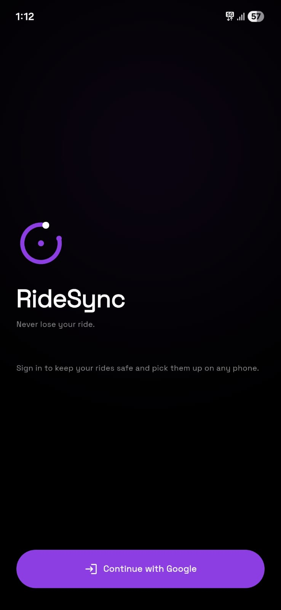</td>
<td valign="middle">

**Continue with Google.**

- One-tap Google Sign-In through Firebase Authentication
- Choose the name other riders see (never your Google name)
- Returning riders skip straight to Home
- Rides and preferences belong to your account, on every phone

</td>
</tr>
</table>

### 🤝 Joining Rides

<table>
<tr>
<td align="center" width="50%">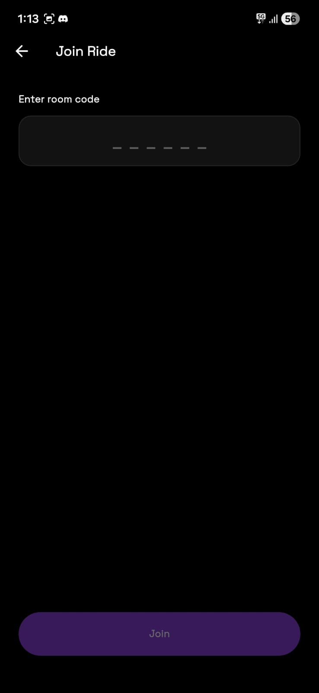<br><sub><b>Join with a room code</b></sub></td>
<td align="center" width="50%">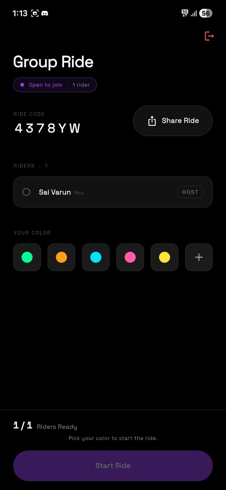<br><sub><b>The group ride lobby</b></sub></td>
</tr>
</table>

> [!TIP]
> The host shares the 6-character ride code (or taps **Share Ride**). Everyone picks a colour in the lobby, and the ride starts once every rider is ready.

### 🗺️ Guided Navigation

<table>
<tr>
<td align="center" width="33%">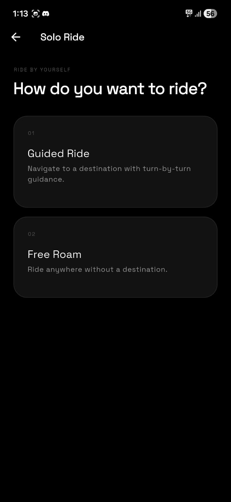<br><sub><b>Guided or Free Roam</b></sub></td>
<td align="center" width="33%">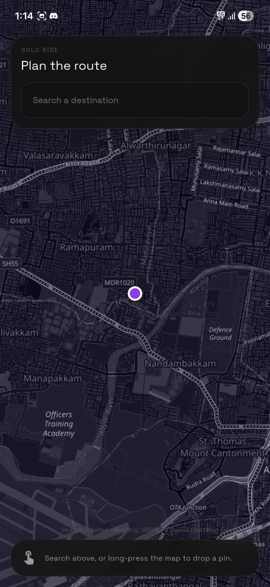<br><sub><b>Search or drop a pin</b></sub></td>
<td align="center" width="33%">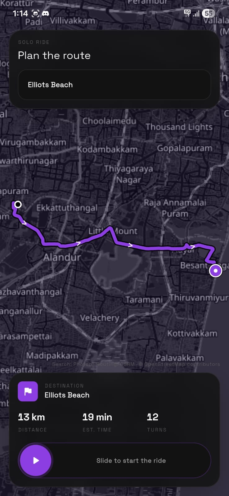<br><sub><b>Route planned, slide to start</b></sub></td>
</tr>
<tr>
<td align="center" width="33%">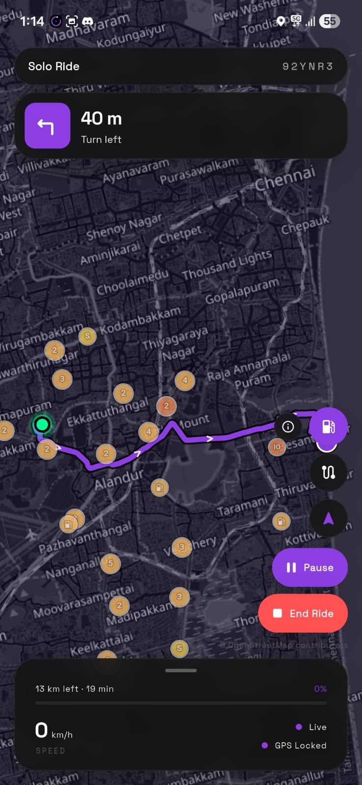<br><sub><b>Turn-by-turn guidance</b></sub></td>
<td align="center" width="33%">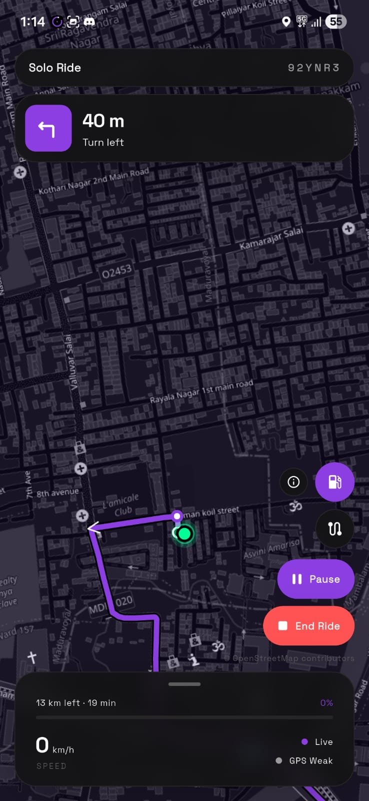<br><sub><b>Following the route</b></sub></td>
<td valign="middle">

- Destination search with **Photon**
- Road routes from **OSRM** with distance, time and turn count
- The next turn, distance left and ETA
- **Fuel stations**, **Pause** and **End Ride** always in view

</td>
</tr>
</table>

### 🚴 Live Ride

<table>
<tr>
<td align="center" width="50%">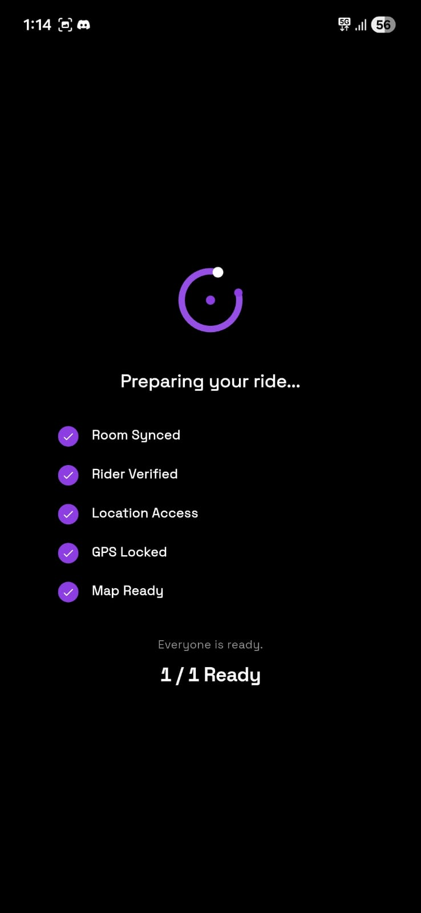<br><sub><b>Preparing your ride</b></sub></td>
<td align="center" width="50%">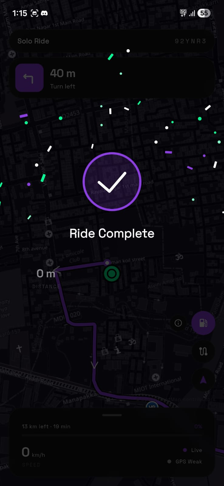<br><sub><b>Ride Complete</b></sub></td>
</tr>
</table>

> [!NOTE]
> Before a ride starts, RideSync checks the room sync, the rider, location access, GPS lock and the map, and waits until every rider is ready. When a ride ends it is saved first, and only then is it shown as complete. Without a connection, the ride is kept on the phone and uploads by itself later.

### 📊 Ride History & Analytics

<table>
<tr>
<td align="center" width="33%">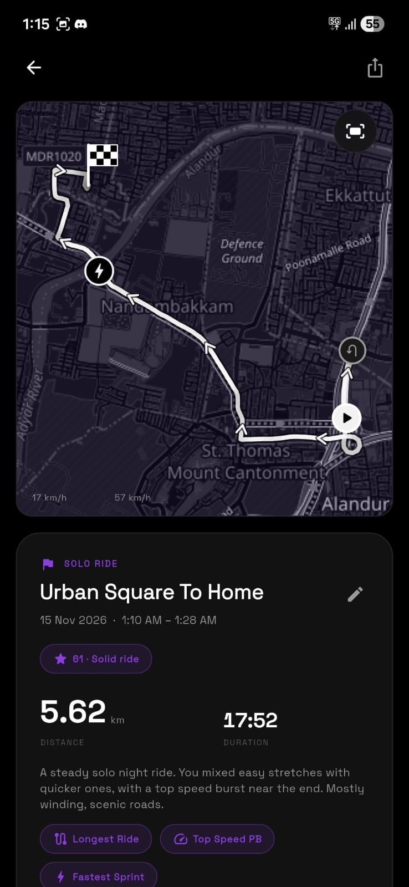</td>
<td align="center" width="33%">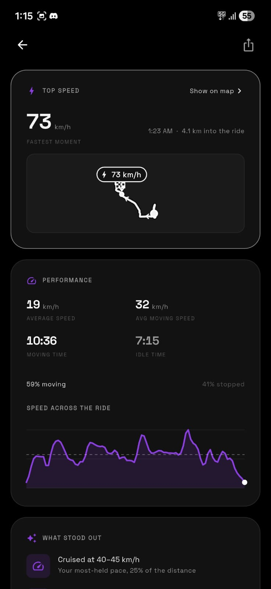</td>
<td align="center" width="33%">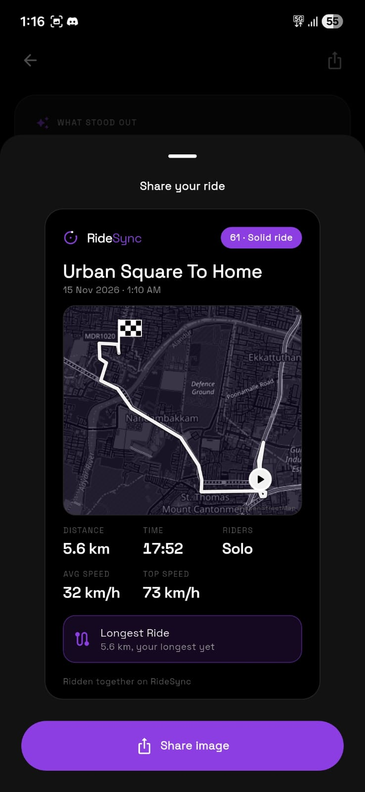</td>
</tr>
<tr>
<td colspan="3" align="center"><sub>Every ride opens as a story: an interactive speed-coloured route map, the ride score and achievements, top speed with where it happened, moving and idle time, a speed graph, and a share-ready card.</sub></td>
</tr>
</table>

### 👤 Profile

<table>
<tr>
<td align="center" width="50%">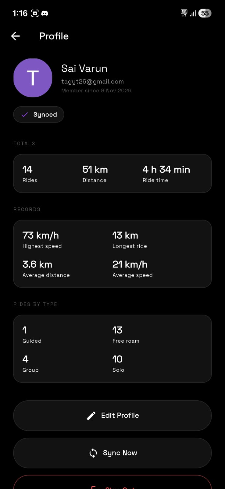</td>
<td valign="middle">

**Your riding, all in one place.**

| | |
|---|---|
| **Totals** | Rides · distance · ride time |
| **Records** | Highest speed · longest ride · averages |
| **Rides by type** | Guided · free roam · group · solo |
| **Cloud sync** | ✓ Synced · Syncing... · Offline |

Plus **Edit Profile** (rider name and solo colour), **Sync Now** and **Sign Out**.

</td>
</tr>
</table>

<br>

## 🧰 Tech Stack

| Layer | Technology | Role |
|---|---|---|
| **App** | [Flutter](https://flutter.dev) · [Dart](https://dart.dev) | Cross-platform UI and app logic |
| **State** | [Riverpod](https://riverpod.dev) | Dependency injection and reactive state |
| **Navigation** | [go_router](https://pub.dev/packages/go_router) | Declarative routing with session-aware redirects |
| **Auth** | [Firebase Authentication](https://firebase.google.com/products/auth) · [Google Sign-In](https://pub.dev/packages/google_sign_in) | Accounts tied to a stable user ID |
| **Live data** | [Firebase Realtime Database](https://firebase.google.com/products/realtime-database) | Rooms, live positions, ride stats and history, with on-disk persistence |
| **Profiles** | [Cloud Firestore](https://firebase.google.com/products/firestore) | Rider profile and synced preferences |
| **Maps** | [flutter_map](https://pub.dev/packages/flutter_map) · [OpenStreetMap](https://www.openstreetmap.org) | Night-style map, routes, trails and markers |
| **Search & fuel** | [Photon](https://photon.komoot.io) · [Overpass API](https://overpass-api.de) | Destination search and fuel stations |
| **Routing** | [OSRM](https://project-osrm.org) | Road routes for guided rides |
| **Places & weather** | [Nominatim](https://nominatim.org) · [Open-Meteo](https://open-meteo.com) | Automatic ride names and ride-start weather |
| **Location** | [Geolocator](https://pub.dev/packages/geolocator) · [flutter_foreground_task](https://pub.dev/packages/flutter_foreground_task) | GPS and background ride recording |
| **Storage** | [shared_preferences](https://pub.dev/packages/shared_preferences) · [path_provider](https://pub.dev/packages/path_provider) | Settings and the on-device ride cache |
| **CI/CD** | [GitHub Actions](https://github.com/features/actions) | Analysis and tests on every push; release builds on tags |

<br>

## 🗂️ Folder Structure

```text
ridesync/
├── lib/
│   ├── app/                 # Bootstrap, app root, router and auth redirects
│   ├── core/                # Theme, shared widgets, errors, haptics, Firebase setup
│   └── features/            # Each feature: data / domain / presentation
│       ├── auth/            # Google Sign-In, rider name, session
│       ├── profile/         # Profile, Edit Profile, statistics, sync status
│       ├── room/            # Home, ride rooms, lobby, joining, solo rides
│       ├── ride/            # Live map, tracking, guidance, leaderboard, auto end
│       ├── history/         # Ride history, details, replay, offline upload queue
│       ├── insights/        # Recap, score, achievements, share cards
│       ├── naming/          # Automatic ride names
│       ├── fuel/            # Fuel station discovery
│       └── ride_card/       # Rider identity card
├── firebase/                # Realtime Database and Firestore security rules
├── screenshots/             # README screenshots
├── docs/release-notes/      # Per-version release notes
├── .github/                 # CI and release workflows, issue and PR templates
├── android/ · ios/          # Platform projects
└── test/                    # Tests
```

> [!IMPORTANT]
> **Architecture:** domain code is plain Dart with no Flutter or Firebase imports. Data sources sit behind repository interfaces (`AuthRepository`, `RideHistoryRepository`, …) that Riverpod injects, so backends can be swapped or faked in tests. Widgets only render state.

<br>

## 📦 Installation

### Prerequisites

| Requirement | Notes |
|---|---|
| [Flutter SDK](https://docs.flutter.dev/get-started/install) | Stable channel (Dart 3) |
| Android Studio or VS Code | With the Flutter extension |
| Android device or emulator | With location services |
| [Firebase](https://console.firebase.google.com) project | Only to run against your own backend |

### Clone and install

```bash
git clone https://github.com/SaiVarun-26/Ridesync.git
cd Ridesync
flutter pub get
```

### Firebase setup

<details>
<summary><b>Use your own Firebase project</b></summary>

<br>

1. Create a Firebase project and add an Android app with the package name `com.ridesync.ridesync`.
2. In **Authentication → Sign-in method**, enable **Google**.
3. Add your signing key's SHA-1 and SHA-256 to the Android app. For local builds that is the debug key:
   ```bash
   keytool -list -v -keystore ~/.android/debug.keystore -alias androiddebugkey -storepass android
   ```
4. Create a **Realtime Database** and a **Cloud Firestore** database.
5. Connect the app (writes `lib/firebase_options.dart` and `android/app/google-services.json`):
   ```bash
   dart pub global activate flutterfire_cli
   flutterfire configure
   ```
6. Deploy the security rules:
   ```bash
   firebase deploy --only database,firestore
   ```

</details>

<br>

## ▶️ Running

```bash
# Run on a connected device or emulator
flutter run

# Static analysis and tests
flutter analyze
flutter test

# Release APK
flutter build apk --release
```

RideSync asks for **location** (choose *Allow all the time* so rides keep recording with the screen off) and **notifications** for the live ride notification.

### 📲 Download the APK

Prefer not to build it yourself? The newest Android build is always on the **[latest release](../../releases/latest)** page, with release notes and a SHA-256 checksum. Every version is listed under **[all releases](../../releases)**.

<br>

## 🛣️ Roadmap

| Status | Feature |
|:---:|---|
| ✅ | Solo and group rides with live tracking |
| ✅ | Guided navigation with turn-by-turn directions |
| ✅ | Live Leaderboard, replay and ride insights |
| ✅ | Fuel stations with brand markers |
| ✅ | Auto End, Pause and Resume |
| ✅ | Google Sign-In, profiles and cloud history |
| 🔜 | Offline maps |
| 🔜 | Voice navigation |
| 🔜 | Crash detection |
| 🔜 | Friends and community rides |
| 🔜 | Ride challenges and achievement collections |
| 🔜 | Live weather along the route |
| 🔜 | Custom themes |
| 💭 | Android Auto and Apple CarPlay |
| 💭 | Wear OS and Apple Watch companions |

<sub>✅ shipped · 🔜 planned · 💭 exploring</sub>

Have an idea? [Request a feature](../../issues/new?template=feature_request.yml).

<br>

## 🤝 Contributing

Contributions are welcome. Please read the [Contributing Guide](CONTRIBUTING.md) and the [Code of Conduct](CODE_OF_CONDUCT.md) first.

| Step | |
|:---:|---|
| **1** | **Fork** the repository and clone your fork |
| **2** | **Branch** from `main`: `git checkout -b feature/short-description` |
| **3** | **Commit** focused changes with [Conventional Commits](https://www.conventionalcommits.org/) (`feat:`, `fix:`, `docs:` …) |
| **4** | **Check** that `flutter analyze` and `flutter test` pass |
| **5** | **Open a pull request** against `main`, with screenshots for UI changes |

<p>
  🐛 <a href="../../issues/new?template=bug_report.yml">Report a bug</a> &nbsp;·&nbsp;
  ✨ <a href="../../issues/new?template=feature_request.yml">Request a feature</a> &nbsp;·&nbsp;
  🔒 <a href="SECURITY.md">Security policy</a>
</p>

<br>

## 📄 License

RideSync is released under the [MIT License](LICENSE).

## 🙏 Credits

Built with [Flutter](https://flutter.dev) and [Firebase](https://firebase.google.com). Maps and places from [OpenStreetMap](https://www.openstreetmap.org/copyright) contributors, rendered with [flutter_map](https://github.com/fleaflet/flutter_map). Search by [Photon](https://photon.komoot.io), fuel data via the [Overpass API](https://overpass-api.de), routing by [OSRM](https://project-osrm.org), place names by [Nominatim](https://nominatim.org) and weather by [Open-Meteo](https://open-meteo.com).

<br>

<div align="center">

**[⬆ Back to top](#ridesync)**

<sub>Made for riders · Map data © <a href="https://www.openstreetmap.org/copyright">OpenStreetMap</a> contributors</sub>

</div>
